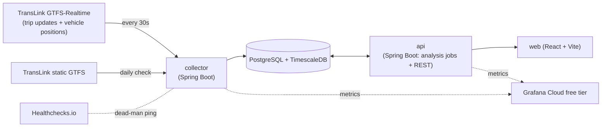

# SFU Bus Reliability Tracker — Mini Plan

A trimmed version of `PLAN.md`. Same core design, smaller MVP, and fixes for the issues found in review.

**Pitch:** "I've tracked every bus to SFU since October — here's how reliable your bus actually is."

---

## 1. What changed from PLAN.md

| Issue | Fix |
|---|---|
| Too much for 3 weeks | MVP is now: collector + analysis + 2 pages (Home, Route detail). Everything else moved to "Later". |
| "When should I leave?" has too little data at launch | Moved to Later. Ships once there are ≥ 30 weekdays of clean data. |
| On-time % is misleading for the R5 (frequent service) | Frequent routes are scored on **gap regularity and excess wait time**, not schedule adherence. |
| 2 GB VPS too small | 4 GB VPS. Grafana Cloud free tier instead of self-hosted Prometheus + Grafana. |
| Observed arrival inferred only from dropped predictions | Validate against vehicle positions in week 1; store both and record which source was used. |
| Cancelled trips counted as ghosts | Separate `cancelled` (announced) from `ghost` (silent no-show). |
| Unique index incompatible with TimescaleDB | Unique index includes the time partitioning column. |
| Launch timing | Collect from week 1; publish the launch post at a high-attention point (midterms / start of next term), not right before December exams. |

---

## 2. MVP scope

| MVP (3 weeks) | Later |
|---|---|
| Collect real-time data for **all** TransLink routes, 24/7 | "When should I leave?" calculator |
| Analysis + UI for SFU routes: **R5, 135, 143, 144, 145** (confirm in GTFS) | Live map |
| Home: route report cards | Alerts ("145 is bunching right now") |
| Route detail: delay/wait by hour, delay along route, ghosts, bunching | Semester / weather comparisons |
| About page: methodology + attribution | Public data export, all-routes UI, PWA |
| Status indicator (data freshness) | Self-hosted Prometheus/Grafana, Terraform |

---

## 3. Architecture



Still two backend services: the collector must never stop, so API/analysis deploys and crashes can't cause
data gaps. Flyway migrations live in `core`; only the collector runs them.

### Repository layout

```
sfu-bus-tracker/
├── README.md
├── PLAN.md / MINIPLAN.md
├── docker-compose.yml          # local: db, collector, api, web
├── docker-compose.prod.yml     # prod: restart policies, volumes, Caddy
├── .env.example
├── .github/workflows/ci.yml    # build + test on PRs
├── .github/workflows/deploy.yml
├── backend/                    # Maven multi-module
│   ├── core/                   # entities, repos, GTFS time utils, Flyway migrations
│   ├── collector/
│   └── api/
├── web/src/pages/              # Home, RoutePage, About
├── infra/scripts/              # backup.sh, restore.sh, server-setup.sh
└── docs/metrics-definitions.md
```

---

## 4. Data model

### Static schedule (versioned)
Unchanged from PLAN.md: every GTFS zip is a `feed_version`; `route`, `stop`, `trip`, `stop_time`,
`calendar`, `calendar_date` all reference it. Times stored as seconds since service-day start
(handles `25:15:00`). Also import `frequencies.txt` if present.

### Real-time (TimescaleDB hypertables)

| Table | Contents |
|---|---|
| `feed_fetch` | one row per poll: time, feed type, HTTP status, latency, entity count, feed header timestamp |
| `vehicle_position` | `feed_timestamp`, vehicle_id, trip_id, lat, lon, current_stop_sequence, status |

- Unique index on **`(vehicle_id, feed_timestamp)`** where `feed_timestamp` is the hypertable time column
  (TimescaleDB requires unique indexes to include it). Insert with `ON CONFLICT DO NOTHING`.
- Compress after 2 days; keep raw positions 90 days; derived tables forever.

### Arrivals (upserted)

| Table | Key | Columns |
|---|---|---|
| `stop_arrival` | `(service_date, trip_id, stop_sequence)` | `predicted_arrival`, `position_arrival`, `observed_arrival`, `source`, `last_seen_at`, `finalized` |

- `predicted_arrival`: last trip-update prediction before the stop dropped out of the feed.
- `position_arrival`: inferred from vehicle positions (first poll where `current_stop_sequence` passes the stop,
  interpolated between the two surrounding polls).
- `observed_arrival`: the value used in stats; `source` records which one (`prediction` / `position`).
  Default rule is chosen after the week-1 validation (section 9).

### Trip status

| Table | What |
|---|---|
| `trip_performance` | per trip per day: scheduled start, observed start, status |

Status values:
- `ran` — a vehicle was assigned and observed.
- `cancelled` — the feed marked the trip `CANCELED` (announced cancellation).
- `ghost` — feed healthy for the whole scheduled window, trip not cancelled, no vehicle ever assigned.
- `unknown` — feed was down or stale during any part of the window.

### Derived

| Table | What |
|---|---|
| `stop_delay` | per finalized arrival: scheduled vs observed, delay seconds |
| `stop_headway` | per arrival on frequent routes: actual gap to previous bus vs scheduled gap |
| `route_hourly_stats` | continuous aggregate per route/direction/hour (see metrics below) |
| `bunching_event` | consecutive buses at a stop with gap < 25% of scheduled gap |
| `feed_outage` | periods where fetches failed or the feed timestamp stopped advancing |

---

## 5. Metrics (`docs/metrics-definitions.md`)

Routes are classified per hour of day:
- **Frequent** if the scheduled gap is **≤ 10 min** for that hour (e.g. R5 most of the day).
- **Scheduled** otherwise (e.g. 143 evenings).

A route can be frequent at 8 AM and scheduled at 11 PM; each hour is scored on its own type.

**Scheduled hours**
- **Delay** = observed − scheduled arrival.
- **On time** = delay between −1 and +3 min.
- Report: on-time %, avg / p50 / p90 delay.

**Frequent hours**
- **Excess wait time** = average wait for a rider arriving at a random moment, minus the wait the schedule
  promises. Computed from actual gaps: `E[wait] = Σgap² / (2·Σgap)`.
- **Gap regularity** = % of gaps within ±50% of the scheduled gap.
- Report: excess wait (minutes), regularity %, bunching count.

**All hours**
- Ghost trips and cancelled trips, counted separately.
- Bunching = gap < 25% of scheduled gap.

**Data-quality labels in the UI**
- Any stat based on < 10 service days is shown with an "early data" badge.
- Hours with `unknown` trips or feed outages are excluded from stats and shown as coverage %.

---

## 6. Services

### collector
- `FeedPoller` — every 30s, fetch both feeds in parallel, 10s timeout, exponential backoff, log to `feed_fetch`.
- `GtfsRealtimeDecoder` — `gtfs-realtime-bindings`.
- `PositionWriter` — JDBC batch insert.
- `ArrivalTracker` — upsert `predicted_arrival` and `position_arrival`; finalize passed stops;
  record `CANCELED` trips.
- `ScheduleLoader` — daily download, sha256 compare, transactional import.
- **Raw archive** — save every Nth feed (e.g. 1 per 10 min) as protobuf to object storage for replay/debugging.
- Micrometer metrics → Grafana Cloud; Healthchecks.io ping after each successful poll.

### api
- **Jobs** (idempotent: re-running a day overwrites it)
  - Hourly: `stop_delay`, `stop_headway`, `trip_performance` for recently completed trips.
  - Nightly: ghosts, cancellations, bunching, outages, aggregate refresh.
- **REST** (read-only, `Cache-Control`)

| Endpoint | Returns |
|---|---|
| `GET /api/routes?focus=sfu` | routes with headline stat (on-time % or excess wait, last 30 days) |
| `GET /api/routes/{id}/stats?from&to&direction` | full stats incl. ghost / cancelled / bunching counts, days of data |
| `GET /api/routes/{id}/hourly?from&to&direction` | per-hour metrics + hour type (frequent / scheduled) |
| `GET /api/routes/{id}/stops` | ordered stops + avg delay per stop |
| `GET /api/status` | data freshness, days collected, coverage %, known outages |

---

## 7. Frontend

Pages: `/` Home, `/routes/:id` Route detail, `/about` Methodology.

### Home

```
┌──────────────────────────────────────────────────────────────┐
│  SFU Bus Tracker                           Home  About       │
├──────────────────────────────────────────────────────────────┤
│  How reliable is your bus up Burnaby Mountain?               │
│  Based on 412,000 observed arrivals over 18 days  [early data]│
│                                                              │
│  ┌────────────┐ ┌──────────┐ ┌──────────┐ ┌──────────┐       │
│  │ R5         │ │ 145      │ │ 144      │ │ 143      │  ...  │
│  │ +1.8 min   │ │ 71% on   │ │ 76% on   │ │ 68% on   │       │
│  │ extra wait │ │ time     │ │ time     │ │ time     │       │
│  │ 64% evenly │ │ avg +3.4m│ │ avg +2.8m│ │ avg +4.0m│       │
│  │ spaced     │ │ 11 ghosts│ │ 5 ghosts │ │ 9 ghosts │       │
│  │            │ │ 2 cancel │ │ 0 cancel │ │ 1 cancel │       │
│  └────────────┘ └──────────┘ └──────────┘ └──────────┘       │
│                                                              │
│  Data last updated 32s ago ●   Coverage 99.2%                │
└──────────────────────────────────────────────────────────────┘
```

### Route detail
- Header stats (type-appropriate: on-time % or excess wait).
- Bar chart by hour of day; bars styled differently for frequent vs scheduled hours.
- Delay along the route (stop → avg delay).
- Ghost / cancelled / bunching counts with the busiest hours.
- Direction + date range selectors.

---

## 8. Infrastructure

| Concern | Choice |
|---|---|
| Server | 1 VPS with **4 GB RAM** (Hetzner CX32 or similar), Ubuntu LTS |
| JVM memory | `-Xmx512m` collector, `-Xmx768m` api; Postgres `shared_buffers=1GB` |
| Deploy | GitHub Actions → GHCR → SSH → `docker compose pull && up -d` (collector only when its image changes) |
| HTTPS | Caddy |
| Monitoring | Grafana Cloud free tier (Micrometer → Prometheus remote write or Grafana Agent) |
| Alerting | Healthchecks.io dead-man switch; Grafana alert on `feed_age_seconds > 300`; disk > 80% |
| Backups | nightly `pg_dump` of static + derived tables to Backblaze B2, 14-day retention; raw feed archive kept separately |

---

## 9. Testing & validation

- **Unit:** GTFS time parsing (`25:15:00`, DST), hour classification, on-time / excess wait / ghost /
  cancelled / bunching rules, protobuf decoding from saved samples.
- **Integration:** Testcontainers (TimescaleDB) running a recorded hour of feeds through the pipeline.
- **Replay CLI:** feed archived protobufs into the collector to reproduce bugs.
- **Arrival validation (week 1, before any stats are published):**
  1. Collect 2–3 days of data.
  2. For ~50 trips on SFU routes, compare `predicted_arrival` vs `position_arrival`.
  3. If they agree within ~60s for most stops, use predictions with position as fallback; otherwise prefer
     positions. Write the result as an ADR in `docs/`.
  4. If possible, spot-check a few arrivals in person at Production Way or SFU Exchange.

---

## 10. Milestones

### Week 1 — Start collecting (data loss here is permanent)
- [ ] TransLink API key; confirm endpoints, rate limits, **terms for storing/publishing**, SFU routes present
- [ ] Check whether static GTFS has `frequencies.txt` and whether the feed uses `CANCELED`
- [ ] Save sample feeds + static zip for tests
- [ ] Maven skeleton, Docker Compose, Flyway migrations
- [ ] Schedule loader, poller, decoder, writers, arrival tracker, raw archive
- [ ] CI workflow
- [ ] **Deploy collector to the VPS by day 5** + Healthchecks.io + Grafana Cloud
- [ ] Start arrival validation once 2–3 days of data exist

### Week 2 — Turn data into answers
- [ ] Finish arrival validation, write ADR, lock the observed-arrival rule
- [ ] Hourly + nightly jobs, hour classification, continuous aggregate
- [ ] REST endpoints
- [ ] Unit + integration tests, replay CLI
- [ ] Deploy workflow for api

### Week 3 — Ship (quietly)
- [ ] React: Home, Route detail, About
- [ ] Caddy + domain + HTTPS, backups
- [ ] README with screenshots, architecture, metric definitions
- [ ] Soft launch: share with a few friends/classmates for feedback; fix anything confusing

### Public launch — later, with more data
- [ ] Wait for ≥ 30 days of data (early/mid November at the earliest)
- [ ] Post at a high-attention moment: midterm season or the first weeks of the next term
- [ ] Launch post with findings (r/simonfraser, r/vancouver, SFU Discords)
- [ ] Then start "When should I leave?" and the live map

---

## 11. Risks

| Risk | Mitigation |
|---|---|
| TransLink terms restrict storage/publishing | Check before coding; attribution on every page |
| Predictions are a poor proxy for arrivals | Week-1 validation; position-based fallback stored for every stop |
| Feed down or frozen | `feed_fetch` log, `feed_outage` detection, `unknown` status, coverage % in UI |
| Schedule changes mid-collection | Versioned `feed_version`, join on the version valid for each service date |
| Memory / disk pressure | 4 GB server, capped JVM heaps, compression, 90-day raw retention, disk alert |
| Early numbers are noisy | "Early data" badge, soft launch first, public launch after 30 days |
| Stats wrong and called out publicly | Published methodology, idempotent jobs, raw archive allows full recompute |

## 12. Decide before coding
1. On-time window (−1 / +3 min proposed).
2. Frequent-service threshold (≤ 10 min gap proposed).
3. Domain name.
