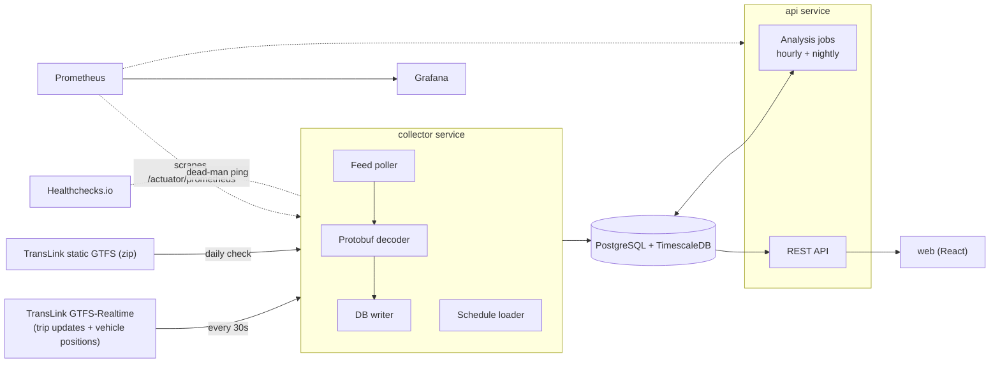

# SFU Bus Reliability Tracker — Project Plan

## 1. Goal

Continuously record TransLink's real-time bus data, compare it against the published schedule, and publish
honest reliability stats for the routes SFU students depend on.

**One-line pitch:** "I tracked every bus to SFU for N months — here's how often your bus is actually on time."

### Scope

| MVP (3 weeks) | Later |
|---|---|
| Collect real-time data for **all** TransLink routes, 24/7 | Comparisons across semesters / weather |
| Analysis + UI focused on SFU routes: **R5, 135, 143, 144, 145** (confirm in GTFS) | Expand UI to all routes |
| Route report cards (on-time %, avg delay, by hour) | Push/email alerts ("145 is bunching right now") |
| "When should I leave?" calculator | Public data export / API |
| Ghost trip counts | Mobile-friendly PWA |
| Live map of SFU buses | Terraform for server provisioning |

---

## 2. Architecture



**Why two backend services instead of one:** the collector must never stop. Splitting it out means
redeploying or crashing the API/analysis code never causes a gap in the data.

---

## 3. Repository layout

```
sfu-bus-tracker/
├── README.md                     # pitch, screenshots, architecture diagram, how to run
├── PLAN.md                       # this file
├── docker-compose.yml            # local dev: db, collector, api, web, prometheus, grafana
├── docker-compose.prod.yml       # prod overrides (restart policies, volumes, no dev ports)
├── .env.example                  # TRANSLINK_API_KEY, DB creds, HEALTHCHECK_URL
├── .github/workflows/
│   ├── ci.yml                    # build + test on every PR
│   └── deploy.yml                # build images, push to GHCR, deploy to VPS on main
│
├── backend/                      # Maven multi-module project
│   ├── pom.xml                   # parent POM
│   ├── core/                     # shared: entities, repositories, GTFS time utils, Flyway migrations
│   │   └── src/main/resources/db/migration/V1__static_gtfs.sql ...
│   ├── collector/                # Spring Boot app: feed poller, schedule loader
│   └── api/                      # Spring Boot app: analysis jobs, REST controllers
│
├── web/                          # React + Vite + TypeScript
│   └── src/
│       ├── pages/                # Home, RoutePage, PlanTrip, LiveMap, About
│       ├── components/           # charts, route cards, map
│       └── api/                  # typed API client
│
├── infra/
│   ├── prometheus/prometheus.yml
│   ├── grafana/dashboards/       # provisioned dashboards (committed as JSON)
│   └── scripts/                  # backup.sh, restore.sh, server-setup.sh
│
└── docs/
    ├── metrics-definitions.md    # exactly how on-time / ghost / bunching are computed
    └── decisions/                # short architecture decision records (ADRs)
```

**Flyway ownership:** migrations live in `core`, and only the **collector** runs them on startup
(`api` has `spring.flyway.enabled=false`). One owner avoids two services racing to migrate.

---

## 4. Data model

### 4.1 Static schedule (versioned)

Every imported GTFS zip becomes a `feed_version`. All static rows reference it, so historical data is always
compared against the schedule that was in effect that day.

| Table | Key columns |
|---|---|
| `feed_version` | `id`, `sha256` of zip, `valid_from`, `valid_to`, `imported_at` |
| `route` | `feed_version_id`, `route_id`, `short_name` (e.g. "145"), `long_name` |
| `stop` | `feed_version_id`, `stop_id`, `name`, `lat`, `lon` |
| `trip` | `feed_version_id`, `trip_id`, `route_id`, `service_id`, `direction_id`, `headsign` |
| `stop_time` | `feed_version_id`, `trip_id`, `stop_sequence`, `stop_id`, `arrival_secs`, `departure_secs` |
| `calendar`, `calendar_date` | which `service_id`s run on which dates |

`arrival_secs` stores seconds since service-day start, because GTFS allows times like `25:15:00` for trips that
run past midnight. Convert to real timestamps only when combined with a `service_date`.

### 4.2 Real-time (raw, TimescaleDB hypertables)

| Table | Contents | Volume (all routes) |
|---|---|---|
| `feed_fetch` | one row per poll: time, HTTP status, latency, entity count, feed header timestamp | ~2,900 rows/day |
| `vehicle_position` | time, vehicle_id, trip_id, lat, lon, current_stop_sequence, status | ~2–3M rows/day |

- Compression policy after 2 days; retention of raw positions: keep ~90 days (derived tables kept forever).
- Unique index on `(vehicle_id, feed_timestamp)` + `ON CONFLICT DO NOTHING` so re-fetching an unchanged feed
  doesn't duplicate rows.

### 4.3 Arrival estimates (upserted, not appended)

Storing every prediction for every remaining stop every 30s would be ~80M+ rows/day. Instead keep only the
**latest** prediction per stop and update it in place:

| Table | Key | Columns |
|---|---|---|
| `stop_arrival` | `(service_date, trip_id, stop_sequence)` | `predicted_arrival`, `last_seen_at`, `finalized` (bool), `source` (`trip_update` / `vehicle_position`) |

When a stop disappears from a trip's predictions (the bus has passed it), its last prediction becomes the
**observed arrival** and the row is marked `finalized`.

### 4.4 Derived (written by analysis jobs)

| Table | What |
|---|---|
| `trip_performance` | per trip per day: scheduled start, observed start, delay at each timepoint, status (`ran` / `ghost` / `unknown`) |
| `stop_delay` | per finalized stop arrival: scheduled vs observed, delay seconds |
| `route_hourly_stats` | TimescaleDB continuous aggregate: on-time %, avg/p50/p90 delay per route, direction, hour |
| `bunching_event` | two vehicles on same route/direction arriving at a stop within the bunching threshold |
| `feed_outage` | periods where `feed_fetch` failed or the feed timestamp stopped advancing |

---

## 5. Metric definitions (put these in `docs/metrics-definitions.md`)

Publish them clearly — credibility depends on it.

- **Delay** = observed arrival − scheduled arrival at a stop.
- **On time** = delay between **−1 min and +3 min** (configurable; document the choice).
- **Ghost trip** = a scheduled trip where the feed was healthy for its whole scheduled window, yet no
  vehicle was ever assigned to it. If the feed was down during the window, status = `unknown`, not `ghost`.
- **Bunching** = at a stop, the gap between consecutive buses on the same route/direction is
  **< 25% of the scheduled gap**.
- **"When should I leave?"** = for a route, stop, and target arrival time, the latest scheduled departure
  whose historical arrival was on time in ≥ 95% (configurable) of observed weekdays.

---

## 6. Services in detail

### collector
- `FeedPoller` — `@Scheduled(fixedDelay = 30s)`; fetch trip updates + vehicle positions in parallel;
  timeout 10s; exponential backoff on errors; log every attempt to `feed_fetch`.
- `GtfsRealtimeDecoder` — uses `com.google.transit:gtfs-realtime-bindings`.
- `PositionWriter` — JDBC batch insert into `vehicle_position`.
- `ArrivalTracker` — upsert `stop_arrival`; finalize stops that dropped out of the feed.
- `ScheduleLoader` — daily: download static GTFS, compare sha256, import new versions in one transaction.
- Metrics: `feed_fetch_total{status}`, `feed_fetch_latency`, `feed_age_seconds`, `rows_written_total`.
- Pings Healthchecks.io after every successful poll → you get emailed if pings stop.

### api
- **Analysis jobs**
  - Hourly: compute `stop_delay`, `trip_performance` for trips completed in the last few hours.
  - Nightly: ghost trips, bunching, feed outages, refresh aggregates for the previous service day.
  - Jobs are **idempotent** (re-running a day overwrites that day) so bugs can be fixed and history recomputed.
- **REST API** (all read-only, cached with `Cache-Control`)

| Endpoint | Returns |
|---|---|
| `GET /api/routes?focus=sfu` | routes with headline stats (on-time % last 30 days) |
| `GET /api/routes/{id}/stats?from&to&direction` | on-time %, avg/p90 delay, ghost count, bunching count |
| `GET /api/routes/{id}/hourly?from&to&direction` | delay by hour of day (for the main chart) |
| `GET /api/routes/{id}/stops` | ordered stops per direction |
| `GET /api/plan?route&stop&arriveBy&confidence` | recommended departure time |
| `GET /api/live?routes=R5,145` | current vehicle positions (last 60s) |
| `GET /api/status` | data freshness, collection coverage, known outages |

---

## 7. Frontend layout

### Pages

```
/                 Home — SFU route report cards
/routes/:id       Route detail — charts and stats
/plan             "When should I leave?"
/live             Live map
/about            Methodology, metric definitions, data attribution
```

### Home

```
┌──────────────────────────────────────────────────────────────┐
│  SFU Bus Tracker                    Home  Plan  Live  About  │
├──────────────────────────────────────────────────────────────┤
│  How reliable is your bus up Burnaby Mountain?               │
│  Based on 1,234,567 observed arrivals since Oct 2026         │
│                                                              │
│  ┌──────────┐ ┌──────────┐ ┌──────────┐ ┌──────────┐         │
│  │ R5       │ │ 145      │ │ 144      │ │ 143      │  ...    │
│  │ 82% on   │ │ 71% on   │ │ 76% on   │ │ 68% on   │         │
│  │ time     │ │ time     │ │ time     │ │ time     │         │
│  │ avg +2.1m│ │ avg +3.4m│ │ avg +2.8m│ │ avg +4.0m│         │
│  │ 3 ghosts │ │ 11 ghosts│ │ 5 ghosts │ │ 9 ghosts │         │
│  └──────────┘ └──────────┘ └──────────┘ └──────────┘         │
│                                                              │
│  Worst time to ride this week: 145 inbound, Mon 8–9 AM       │
│  Data last updated 32s ago ●                                 │
└──────────────────────────────────────────────────────────────┘
```

### Route detail

```
┌──────────────────────────────────────────────────────────────┐
│  145  SFU ⇄ Production Way      [To SFU ▾]  [Last 30 days ▾] │
├──────────────────────────────────────────────────────────────┤
│  On time 71%   Avg delay +3.4m   p90 +8.1m   Ghosts 11       │
│                                                              │
│  Delay by hour of day (bar chart)                            │
│  ▁▁▂▅█▇▄▃▃▄▅▇█▆▃▂▁                                           │
│  6am           12pm            6pm                           │
│                                                              │
│  Delay along the route (line chart: stop → avg delay)        │
│                                                              │
│  Bunching events this month: 42  (most at 8–9 AM)            │
└──────────────────────────────────────────────────────────────┘
```

### Plan

```
┌──────────────────────────────────────────────────────────────┐
│  When should I leave?                                        │
│  Route [145 ▾]  From stop [Production Way Stn ▾]             │
│  I need to arrive at SFU by [08:30]   Confidence [95% ▾]     │
│                                                              │
│  → Catch the 7:52 bus.                                       │
│    It reached SFU by 8:30 on 19 of 20 recent weekdays.       │
│    The 8:02 only made it 13 of 20 times.                     │
└──────────────────────────────────────────────────────────────┘
```

### Live

Full-width MapLibre map, SFU routes drawn from GTFS shapes, bus markers coloured by current delay
(green / yellow / red), refreshed every 30s.

---

## 8. Infrastructure

| Concern | Choice |
|---|---|
| Server | 1 VPS (Hetzner CX22 / DigitalOcean 2GB, ~$5–7/month), Ubuntu LTS |
| Deploy | GitHub Actions builds images → GHCR → SSH to VPS → `docker compose pull && up -d` |
| Reverse proxy + HTTPS | Caddy (automatic Let's Encrypt) |
| Secrets | `.env` on server only; GitHub Actions secrets for deploy key |
| Monitoring | Prometheus + Grafana (collector health, feed age, rows/min, API latency) |
| Alerting | Healthchecks.io dead-man switch on collector; Grafana alert if `feed_age_seconds > 300` |
| Backups | nightly `pg_dump` of derived tables + static GTFS to object storage (Backblaze B2 / S3), 14-day retention |
| Deploy safety | collector and api deploy independently; collector only redeploys when its image changes |

---

## 9. Testing

- **Unit:** GTFS time parsing (`25:15:00`, DST transitions), on-time/ghost/bunching rules, protobuf decoding
  using saved sample feeds in `src/test/resources`.
- **Integration:** Testcontainers with the TimescaleDB image — run the full pipeline on a recorded hour of feed
  data and assert the computed stats.
- **Replay tool:** a small CLI that feeds saved protobuf files into the collector, so analysis bugs can be
  reproduced without waiting for live data.
- **CI:** all of the above on every pull request.

---

## 10. Milestones

### Week 1 — Start collecting (the most important week)
- [ ] Register for a TransLink API key; confirm endpoints, rate limits, terms, and that SFU routes appear
- [ ] Save a few sample real-time feeds + the static GTFS zip for tests
- [ ] Maven multi-module skeleton, Docker Compose with TimescaleDB
- [ ] Flyway migrations for static GTFS + `feed_fetch` + `vehicle_position` + `stop_arrival`
- [ ] Schedule loader
- [ ] Feed poller, decoder, writers, arrival tracker
- [ ] CI workflow
- [ ] **Provision VPS and deploy the collector by end of week 1** + Healthchecks.io alert

### Week 2 — Turn data into answers
- [ ] Hourly + nightly analysis jobs (delays, trip performance, ghosts, bunching, outages)
- [ ] Continuous aggregate for hourly route stats
- [ ] REST API endpoints
- [ ] Unit + Testcontainers integration tests, replay tool
- [ ] Prometheus + Grafana dashboards
- [ ] Deploy workflow

### Week 3 — Ship it
- [ ] React app: Home, Route detail, Plan, Live, About
- [ ] Caddy + domain + HTTPS
- [ ] Backups
- [ ] README with screenshots, architecture diagram, metric definitions
- [ ] Launch post with first findings (r/simonfraser, r/vancouver, SFU Discords)

---

## 11. Risks & open questions

| Risk | Mitigation |
|---|---|
| TransLink terms restrict storage or publishing | Read terms before week 1 coding; include required attribution on every page |
| Trip updates don't include per-stop predictions | Fall back to inferring arrivals from `vehicle_position` (nearest point to stop + `current_stop_sequence`) |
| Feed goes down or freezes | `feed_fetch` log + `feed_outage` detection; never count outage windows as ghost trips |
| Schedule changes mid-collection | Versioned `feed_version`; analysis always joins on the version valid for that service date |
| VPS disk fills | Compression + 90-day raw retention + disk usage alert |
| Stats are wrong and someone notices publicly | Publish methodology; idempotent jobs so history can be recomputed after a fix |

**Decide before coding:**
1. Exact on-time window (−1/+3 min proposed).
2. Collect all routes (proposed) vs SFU-only.
3. Domain name.
