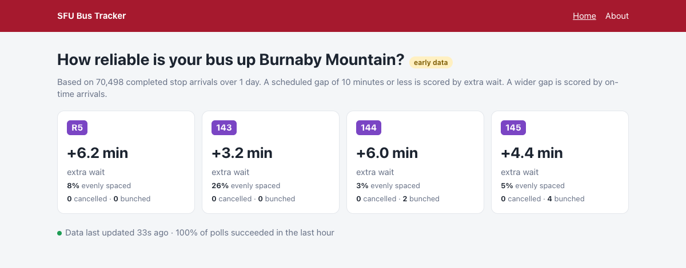

# SFU Bus Tracker

Records every TransLink bus in Metro Vancouver and scores the routes that serve SFU: **R5, 143, 144, and 145**.

A collector polls TransLink all day and writes into TimescaleDB. A read-only API scores those rows. The site shows the scores.

**Live demo:** [http://16.174.148.60/](http://16.174.148.60/)

A route is marked early data until 10 service days are stored.

If the usual gap between buses is 10 minutes or less, the score is extra wait and how even the gaps are. If the gap is wider, the score is the share of arrivals from 1 minute early to 3 minutes late. On-time percent is not shown for the frequent hours.

Data comes from TransLink’s GTFS feeds. TransLink is not responsible for the scores.

## How data gets in

Once a day, at 04:15 Pacific, the collector downloads the static schedule zip. It stores a new copy only when the file hash changes. Times like `25:15:00` stay on the same service day.

All day it polls two live feeds. Trip updates every 2 minutes (720 requests). Vehicle positions every 6 minutes (240 requests). The daily cap is 1,000, so the collector stops at 960. Each poll is counted in `api_request` before it is sent. Each attempt is logged in `feed_fetch`.

A raw copy of a feed is saved about every 10 minutes and kept for 14 days. Scores use the database, not those files.

Cleaning applied before a row is used in a score:

- The same stop can appear twice in one update. The last prediction is kept.
- A stop drops out of later updates once the bus has passed it. That stop is marked final, and `observed_arrival` is set to the last prediction.
- Scores use finalized stops only.
- A vehicle position can also stamp `position_arrival` on stops the bus has already passed. Those times are stored. Scores do not use them yet.
- A trip marked `CANCELED` goes in `trip_notice`, not in `stop_arrival`.
- A scheduled trip that never appeared is not counted until a full service day is stored.

Times in the database are UTC. Service dates are `America/Vancouver`.

## Schema

PostgreSQL with TimescaleDB. The collector is the only writer and the only process that runs migrations.

Schedule tables are copied from the static GTFS zip. Each import is one `feed_version`. The other schedule tables use `(feed_version_id, …)` as their key, so an old schedule stays queryable after a new one arrives.

### feed_version

One row per imported schedule file.

| Column | Type | |
|---|---|---|
| id | bigserial, primary key | |
| sha256 | text, unique | hash of the zip |
| valid_from | date | first day the feed says it covers |
| valid_to | date | last day, null while this version is current |
| imported_at | timestamptz | when this copy was loaded |

### route

| Column | Type | |
|---|---|---|
| feed_version_id | bigint, primary key | |
| route_id | text, primary key | TransLink’s route id |
| short_name | text | public number, such as `145` or `R5` |
| long_name | text | |
| route_type | int | GTFS route type |

### stop

| Column | Type | |
|---|---|---|
| feed_version_id | bigint, primary key | |
| stop_id | text, primary key | |
| name | text | |
| lat | double precision | |
| lon | double precision | |

### trip

| Column | Type | |
|---|---|---|
| feed_version_id | bigint, primary key | |
| trip_id | text, primary key | |
| route_id | text | |
| service_id | text | which calendar this trip follows |
| direction_id | int | 0 or 1 |
| headsign | text | destination shown on the bus |

### stop_time

One scheduled stop on one trip. `arrival_secs` is seconds after midnight on the service day, and it can be greater than 24 hours.

| Column | Type | |
|---|---|---|
| feed_version_id | bigint, primary key | |
| trip_id | text, primary key | |
| stop_sequence | int, primary key | order of the stop on the trip |
| stop_id | text | |
| arrival_secs | int | scheduled arrival |
| departure_secs | int | scheduled departure |

### calendar

Which weekdays a `service_id` runs, and the date range.

| Column | Type | |
|---|---|---|
| feed_version_id | bigint, primary key | |
| service_id | text, primary key | |
| monday … sunday | boolean | |
| start_date | date | |
| end_date | date | |

### calendar_date

A single-day exception. `exception_type` 1 adds service, 2 removes it.

| Column | Type | |
|---|---|---|
| feed_version_id | bigint, primary key | |
| service_id | text, primary key | |
| service_date | date, primary key | |
| exception_type | int | |

### frequency

Used when a trip is defined by a headway instead of a list of departure times. This feed often has no rows here.

| Column | Type | |
|---|---|---|
| feed_version_id | bigint, primary key | |
| trip_id | text, primary key | |
| start_secs | int, primary key | |
| end_secs | int | |
| headway_secs | int | |

### feed_fetch

Hypertable on `fetched_at`. One row per poll. Compressed after 7 days.

| Column | Type | |
|---|---|---|
| fetched_at | timestamptz | when the request was made |
| feed_type | text | `trip-updates` or `positions` |
| http_status | int | |
| latency_ms | int | |
| entity_count | int | how many entities were in the body |
| feed_timestamp | timestamptz | timestamp inside the feed |
| error | text | set when the poll or the insert failed |

### stop_arrival

Hypertable on `service_date`, in 7-day chunks. Compressed after 3 days. Primary key is `(service_date, trip_id, stop_sequence)`. This is the table the scores read.

| Column | Type | |
|---|---|---|
| service_date | date, primary key | Vancouver service day |
| trip_id | text, primary key | |
| stop_sequence | int, primary key | |
| stop_id | text | |
| predicted_arrival | timestamptz | latest prediction from the trip-update feed |
| position_arrival | timestamptz | time inferred from a later vehicle position |
| observed_arrival | timestamptz | the time used for scores, set when the stop is finalized |
| source | text | `prediction` today |
| last_seen_at | timestamptz | last feed that mentioned this stop |
| finalized | boolean | true once the stop has dropped out of the live feed |
| schedule_relationship | text | value from the feed, when present |

Index: `(stop_id, service_date)`.

### vehicle_position

Hypertable on `feed_timestamp`. Primary key is `(vehicle_id, feed_timestamp)`. Compressed after 2 days. Rows older than 90 days are deleted.

| Column | Type | |
|---|---|---|
| feed_timestamp | timestamptz, primary key | |
| vehicle_id | text, primary key | |
| trip_id | text | |
| route_id | text | |
| lat | double precision | |
| lon | double precision | |
| current_stop_sequence | int | |
| current_status | text | |

Index: `(trip_id, feed_timestamp)`.

### trip_notice

A trip the feed marked cancelled. Primary key is `(service_date, trip_id)`.

| Column | Type | |
|---|---|---|
| service_date | date, primary key | |
| trip_id | text, primary key | |
| relationship | text | `CANCELED` |
| last_seen_at | timestamptz | |

### api_request

One row per Vancouver day. The collector will not poll once `count` reaches 960.

| Column | Type | |
|---|---|---|
| day | date, primary key | |
| count | int | requests already spent that day |

## Java and Spring Boot

Three Maven modules, Java 21, Spring Boot 3.5.6. There is no JPA. Both apps talk to Postgres with `JdbcTemplate` and SQL.

`core` is a plain library. `GtfsTime` parses schedule times, including hours past 24. The Flyway files live here, in `db/migration`. `core` does not start a server.

`collector` is a Spring Boot app. `CollectorApplication` turns on scheduling and configuration properties. `FeedPoller` uses `@Scheduled` for the two live feeds. `ScheduleLoader` uses `@Scheduled` with a cron at 04:15 Pacific, and it also runs once at startup. Settings such as the API key, URLs, and the 960 request budget are `@ConfigurationProperties` under `collector.*`. HTTP calls use Java’s `HttpClient`. Trip updates and positions are decoded with the GTFS Realtime protobuf library. The static zip is read with Apache Commons CSV. Writes go through `RealtimeStore`, and each batch of trips or positions is one `@Transactional` method. On startup, Flyway applies any new migration. Spring Boot Actuator exposes `GET /actuator/health` on port 8080.

`api` is a second Spring Boot app, on port 8081. It does not depend on `core`, and it does not run Flyway. `RouteController` is a `@RestController`. `RouteService` loads rows through `StatsRepository`. `Reliability` is plain Java: the on-time window, the 10-minute frequent cutoff, extra wait, regularity, and bunching. JUnit tests cover those rules. Responses send `Cache-Control: max-age=30`.

| Method | Path | Returns |
|---|---|---|
| GET | `/api/status` | last poll, coverage in the last hour, days stored, arrival counts |
| GET | `/api/routes?focus=sfu` | one card per SFU route |
| GET | `/api/routes/{id}` | the full report for one route |
| GET | `/api/routes/{id}/stats` | the headline numbers |
| GET | `/api/routes/{id}/hourly` | one row per hour |
| GET | `/api/routes/{id}/stops` | average delay at each stop |

`from`, `to`, and `direction` are optional. The default range is the last 30 days through today in Vancouver. Any `focus` other than `sfu` returns an empty list.

## The site and CI

The site is React 19, React Router, and Vite. In development, Vite proxies `/api` to port 8081. The production build is static files. Caddy serves them and proxies `/api` to the API.

GitHub Actions runs `mvn -B -f backend/pom.xml test` on every push and pull request. That is Java 21 on Temurin.

## Where it runs

One EC2 instance in Calgary (`ca-west-1`): a `t4g.medium` with 4 GB of memory and a 12 GB disk. The site is [http://16.174.148.60/](http://16.174.148.60/).

Docker runs the database and the collector together. They come back after a reboot. Postgres listens on localhost only. Caddy serves the site on port 80 and forwards `/api` to the API on localhost. The API does not poll TransLink. SSH is open to one address. The database port is not open to the internet.
